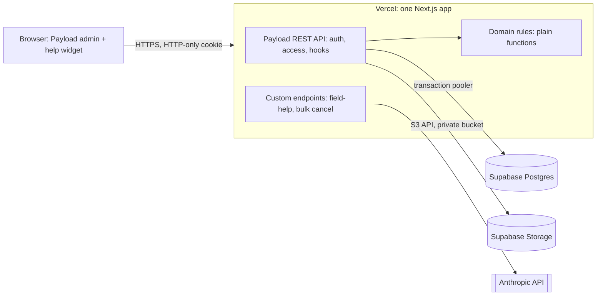
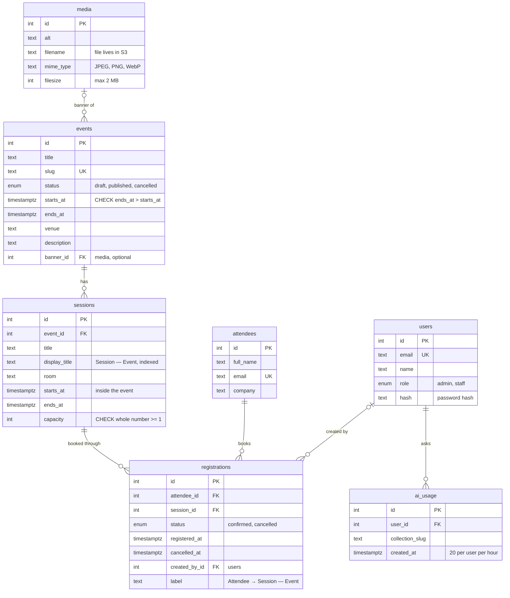

# Event Registration admin

Admin panel for conference events, sessions, attendees and seat-limited registrations. Payload 3 on
Next.js, Postgres and S3 storage on Supabase, deployed on Vercel.

Live: https://benrey-home-assigment.vercel.app/admin (admin and staff logins are in the email).

## Run locally

Node 24, pnpm 10 and Docker.

```bash
docker compose up -d       # Postgres on :54329, MinIO on :9000
cp .env.example .env       # set PAYLOAD_SECRET to `openssl rand -hex 32`
pnpm install
pnpm migrate
pnpm seed --reset          # 30 events, ~160 sessions, 2,000 attendees, ~8,000 registrations
pnpm dev                   # http://localhost:3000/admin, logins from SEED_* in .env
```

## Deploy

1. Supabase: create a project, a private Storage bucket and S3 keys.
2. Run `pnpm migrate` and `pnpm seed --reset` from your machine against the session pooler
   (port 5432). The remote seed takes 30–60 minutes. Seed before going live: on an empty database
   the first account to sign up becomes admin.
3. Vercel: import the repo and set `DATABASE_URL` (transaction pooler, port 6543),
   `PAYLOAD_SECRET`, the `S3_*` variables, `NEXT_PUBLIC_SERVER_URL` and optionally
   `ANTHROPIC_API_KEY`.

Secrets live only in Vercel and in a local `.env`, and the app won't start if one is missing.
Logins only work on `NEXT_PUBLIC_SERVER_URL`, not on preview URLs (CSRF and CORS).

## Why Payload

The brief asks for the framework's built-in admin, and TypeScript is my main language, so I picked
Payload 3. It builds the admin from TypeScript config and gives me auth, field-level access and
hooks. It runs inside Next.js, so the whole app is one deploy. The seat limit needs row locks, so I
wanted Postgres; Supabase gives me Postgres and S3 storage in one place.

Without a deadline I would split it: a NestJS API and a client-only admin with React Admin,
TanStack Query and Vite. An internal admin doesn't need SSR or SEO, and a separate API is easier to
test and scale. For login I would use Better Auth with OAuth, and new OAuth users would get no role
until an admin approves them.

## Architecture



The important part is the seat limit. When staff save a registration, a hook checks the rules and
returns a clear error like "Session is full". Then a Postgres trigger locks the session row and
counts again, so if two people take the last seat at the same moment, only one gets it. The hook
gives the message; the database decides the race.

Rules are plain functions in `src/domain/registration`; access rules are in `src/access/roles.ts`.

## Data model



`registrations` is the many-to-many between attendees and sessions. It's a real table, not just a
join table, because each booking has a status, dates and the person who created it. Seats left and
session counts are calculated when read, not stored.

## Rules

| # | Rule | Checked in |
|---|---|---|
| 1 | Confirmed registrations ≤ capacity | hook + database (session row lock) |
| 2 | An attendee can't be in two overlapping sessions | hook + database (attendee row lock) |
| 3 | Only published events, only sessions that haven't ended | hook |
| 4 | Capacity can't go below the confirmed count | hook + database |
| 5 | A session stays inside its event's dates | hook |
| 6 | Cancelling is final | hook + database |
| 7 | A registration's attendee and session can't change | hook + field access |
| 8 | One confirmed registration per attendee and session | hook + unique index |

## Roles

| | Admin | Staff |
|---|---|---|
| Users | everything, but can't delete themselves or the last admin | own account only |
| Events, sessions, images | everything | read only |
| Attendees | everything | create, edit |
| Registrations | everything | create, cancel |

Staff don't see the Users menu at all, and the API refuses anything the UI hides.

## AI helper

The "Ask about this form" button sends the question and the form's name. The server builds the
prompt from that form's real field definitions, its rules and what this user is allowed to do. No
record data goes to the model. It's one call to Claude Opus 5.5 at low effort, limited to 20
questions per user per hour, and the API key has a spend limit. If there's no key, or the call fails
or takes more than 16 seconds, the widget says it's offline and the admin keeps working.

There is no separate moderation step yet. The risk is small: the model only sees form definitions
and has no tools, so a bad prompt can't leak data or change anything. For a public-facing version
I would check the question first with a guardrail such as Amazon Bedrock Guardrails.

## Tests

- `pnpm test`: 95 unit tests for the rules, the AI prompt and its error handling, and a check that
  the diagram above matches the schema.
- `pnpm test:int`: 56 tests against real Postgres and MinIO, including two requests racing for the
  last seat.
- `pnpm test:e2e`: 6 Playwright tests in Chromium on their own database and port, so they don't
  touch `pnpm dev`. Run `pnpm exec playwright install chromium` once; to watch them,
  `E2E_SLOWMO=500 pnpm test:e2e --headed`.

## Trade-offs

- **Seats left is counted on every read.** Simple and always correct, but each row in a list costs
  a query. A counter column updated by the trigger would scale better.
- **The seat and overlap rules live in both the hook and the database.** That's some duplication,
  but I get clear error messages and correctness under concurrency.
- **Images go through the app**, so only signed-in staff can see them. The cost is no CDN caching.
- **The AI rate limit is a Postgres table.** No extra service to run, but it isn't atomic; the API
  key's spend limit is the real cap.

## Skipped

Waitlist, public sign-up, emails (so no password reset by email; an admin sets a new password),
OAuth, check-in and payments. The brief is about the admin, so I spent the time on the seat-limit
race instead.

## With more time

A stored seat counter, rules 3 and 5 in the database, Sentry and Better Stack for errors and logs
(today they only go to Vercel's runtime logs), a moderation step in front of the AI helper, images
through a CDN, bulk actions across pages, an audit log, Playwright in CI, and the NestJS + React
Admin split described above.
