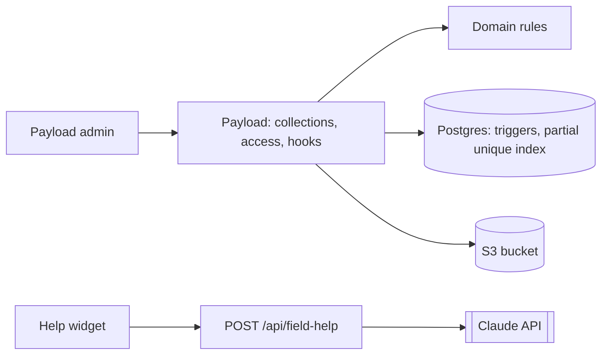

# Event Registration admin

An admin app for conference events, sessions, attendees and seat-limited registrations, built on
Payload 3 inside Next.js with Postgres and S3 storage.

Live: https://benrey-home-assigment.vercel.app/admin. Admin and staff logins are sent with the
submission.

## Local setup

Requires Node 24, pnpm 10 and Docker.

```bash
docker compose up -d       # Postgres on :54329, MinIO on :9000
cp .env.example .env       # set PAYLOAD_SECRET to `openssl rand -hex 32`
pnpm install
pnpm migrate
pnpm seed --reset          # 2 users, 30 events, ~160 sessions, 2,000 attendees, ~8,000 registrations
pnpm dev                   # http://localhost:3000/admin, logins from SEED_* in .env
```

## Deploy

1. Supabase: create a project, a private Storage bucket and S3 access keys.
2. From your machine, with `DATABASE_URL` set to the session pooler (5432) or direct URL plus the
   S3, `PAYLOAD_SECRET` and `SEED_*` variables, run `pnpm migrate` and then `pnpm seed --reset`
   (30–60 minutes against a remote database: every write is a network round trip). Seed before the app goes live: on an empty database
   the first account registered becomes admin.
3. Vercel: import the repo and set `DATABASE_URL` (transaction pooler, 6543), `PAYLOAD_SECRET`, the
   five `S3_*` variables, `NEXT_PUBLIC_SERVER_URL` and optionally `ANTHROPIC_API_KEY`. Deploy.
   Later schema changes: run `pnpm migrate` the same way, or set `PAYLOAD_MIGRATE_ON_INIT=true`.
4. Share the production URL only. CSRF and CORS accept `NEXT_PUBLIC_SERVER_URL` alone, so logins
   fail on preview URLs.

The build needs no secrets. The server, CLI, seed and tests refuse to start when a required
variable is missing.

## Architecture



Business rules are pure functions in `src/domain/registration`. Hooks load data, call a rule and
throw its message; each hook is a named function next to its collection. Access rules live in
`src/access/roles.ts`, and every custom endpoint starts with `requireStaff` from
`src/endpoints/guards.ts`.

## Why this stack

Payload generates the admin from TypeScript config and includes auth, field-level access and
hooks. Django admin would add a Python backend; Strapi and Directus are harder to shape into
role-specific, rule-heavy screens; AdminJS leaves the ORM and auth to wire by hand. Running Payload
inside Next.js gives one deployable, Drizzle comes with Payload's Postgres adapter, and Supabase
provides Postgres and S3 storage from one vendor. Cloudflare D1 was ruled out because SQLite has
no row locks for the capacity rule.

Trade-off under time pressure: "seats left" is a `COUNT` per session row on read. That is fine
for lists of 50; a counter maintained by the trigger would scale better.

Beyond the brief, on purpose: the database constraints, because capacity under concurrency is the
real correctness risk. The rest is kept small to pay for it: no waitlist, public site or emails.

## Business rules

| # | Rule | Enforced by |
|---|---|---|
| 1 | Confirmed registrations ≤ capacity | hook + trigger with a session row lock |
| 2 | No overlapping confirmed sessions per attendee | hook + trigger with an attendee row lock |
| 3 | Only published events, sessions not ended | hook |
| 4 | Capacity can't drop below confirmed count | hook + trigger |
| 5 | Session inside its event | hook |
| 6 | Cancel is one-way; attendee and session fixed | hook + trigger |
| 7 | One confirmed registration per attendee and session | hook + partial unique index |

Database errors map back to the hook's message, for example "Session is full".

## Roles

| Collection | Admin | Staff |
|---|---|---|
| Users | full; can't delete self or the last admin | own account only |
| Events, sessions, images | full | read |
| Attendees | full | create, update |
| Registrations | full | create, cancel |

## AI helper

The widget sends a collection name and a question. The server builds the context from the
Payload config and the user's own permissions: field labels, types, limits, descriptions and the
collection's rules. One request goes to Claude Opus 5.5 at low effort through the Anthropic SDK,
about a cent or two per question. Each user gets 20 questions an hour; the API key's spend limit is
the hard cap. Without a key, or when the call fails or times out (16 s), the widget says it is
offline and the field descriptions still explain the form.

## Tests

`pnpm test` runs 90 unit tests with no network. `pnpm test:int` runs 56 integration tests against
Docker Postgres and MinIO, including parallel races for the last seat and for overlapping bookings.

`pnpm test:e2e` runs 6 Playwright tests in Chromium against a production build on port 3100 with
its own `benrey_e2e` database, so `pnpm dev` and its data are untouched. They cover the role
difference, editing a session inside its event, the help widget inside that drawer (the AI call
is stubbed), "Session is full", bulk cancel, and a connection lost during bulk cancel. Run
`pnpm exec playwright install chromium` once. To watch it: `E2E_SLOWMO=500 pnpm test:e2e --headed`.

## Skipped

Waitlist; public sign-up or public API; email sending; OAuth (new OAuth users would get no role
until an admin assigns one); check-in and payments.

## With more time

A trigger-maintained seat counter, rules 3 and 5 in the database, saved filter presets, bulk
cancel across pages, an audit log, and the Playwright suite in CI.
